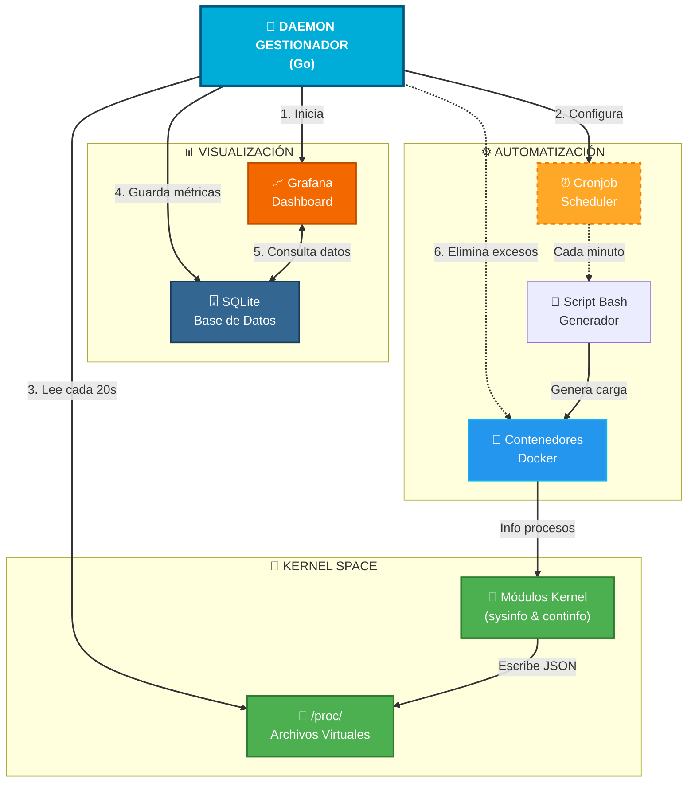
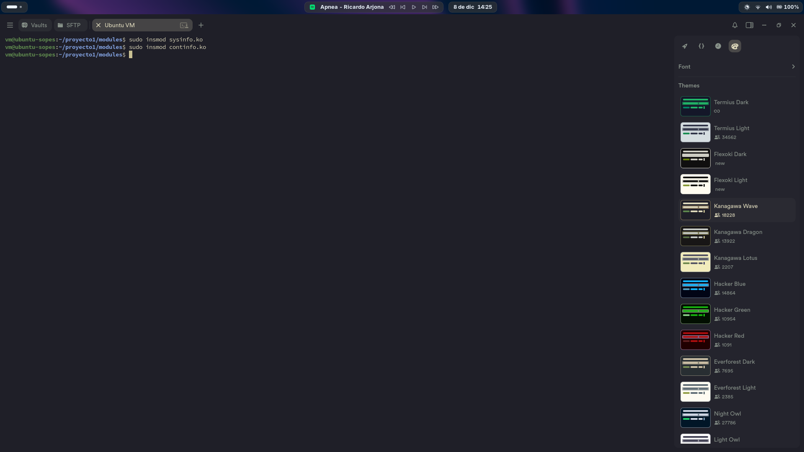
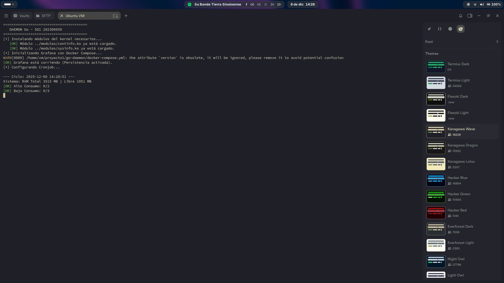
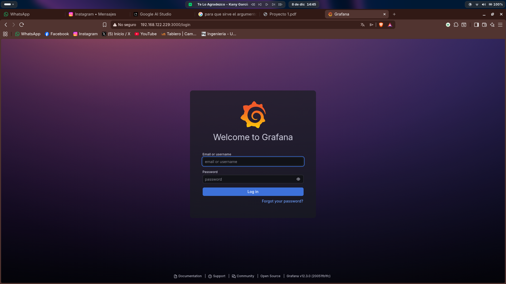
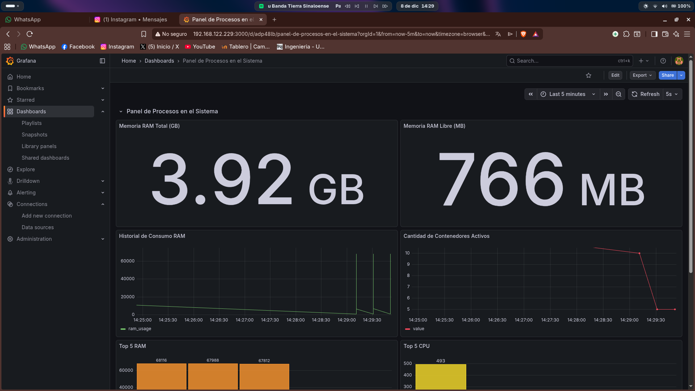
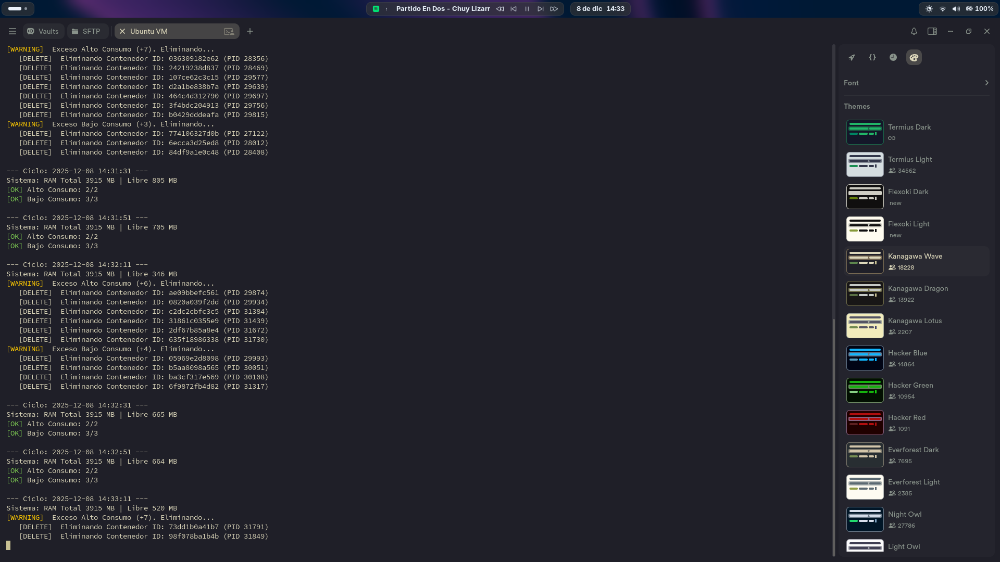

# MANUAL DE USUARIO

## Proyecto 1: Desarrollo de un módulo de kernel en C y un daemon en Go para el monitoreo de procesos y contenedores en Linux
**Sistemas Operativos 1**

---

## 1. Introducción

Este sistema es una herramienta integral diseñada para **monitorear, visualizar y gestionar automáticamente** el rendimiento de contenedores Docker y recursos del sistema en tiempo real. Utiliza módulos de Kernel personalizados para obtener datos precisos y un "cerebro" automatizado que mantiene la estabilidad del servidor eliminando procesos que consumen recursos excesivos.

---

## 2. Arquitectura del Sistema  

El sistema funciona mediante la interacción de cuatro componentes principales:

- **Sensores (Kernel)**: Se instalan en el núcleo de Linux para leer la memoria y CPU real.
- **Cerebro (Daemon Go)**: Un programa que analiza los datos cada 20 segundos y decide qué contenedores deben vivir o morir para proteger tu computadora.
- **Visualización (Grafana)**: Un tablero web donde puedes ver gráficas históricas.
- **Simulación (Docker)**: Generación automática de contenedores de prueba cada minuto.

### Diagrama de Arquitectura




---

## 3. Requisitos del Sistema

Antes de iniciar, asegúrese de tener instalado:

- **Sistema Operativo**: Linux (Ubuntu 20.04/22.04 recomendado)
- **Docker y Docker Compose**
- **Go (Golang)** versión 1.20 o superior
- **GCC y Make** (para compilar módulos del kernel)

---

## 4. Guía de Instalación y Ejecución

### Paso 1: Compilar Módulos del Kernel

Este paso ya lo realiza el programa, pero si lo quiere hacer manualmente, abra una terminal en la carpeta `/modules` y ejecute:

```bash
make
sudo insmod sysinfo.ko
sudo insmod continfo.ko
```



---

### Paso 2: Iniciar el Sistema (Daemon)

El Daemon de Go se encarga de todo (Base de datos, Cronjob y Grafana). Ejecute desde la carpeta `/go-daemon`:

```bash
sudo go run main.go
```

Verá una pantalla indicando que los servicios han iniciado.



---

## 5. Acceso al Dashboard (Grafana)

Una vez el programa esté corriendo, abra su navegador web favorito:

1. Ingrese a la dirección: **http://localhost:3000**
2. **Usuario**: `admin`
3. **Contraseña**: `admin` (Puede saltar el cambio de contraseña)



Una vez dentro, diríjase a la sección **Dashboards** y abra el tablero **"Dashboard SO1"**. Podrá observar métricas en tiempo real:

- **Consumo de RAM**: Histórico de memoria utilizada
- **Contenedores Activos**: Cantidad de contenedores en el sistema
- **Top 5**: Gráficas de pastel con los procesos más pesados



---

## 6. Funcionamiento Automático

El sistema creará contenedores cada minuto. Usted podrá observar en la terminal cómo el Daemon detecta el exceso de consumo y elimina contenedores automáticamente para mantener el equilibrio **(2 Altos, 3 Bajos)**.



---

## 7. Detener el Sistema

Para detener todo el sistema de forma segura, vaya a la terminal donde corre Go y presione:

```
Ctrl + C
```

El sistema limpiará el Cronjob y detendrá los contenedores de forma ordenada.